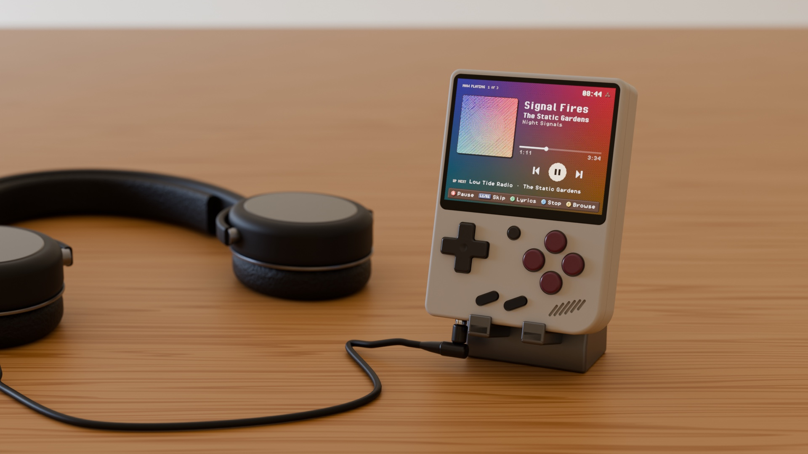
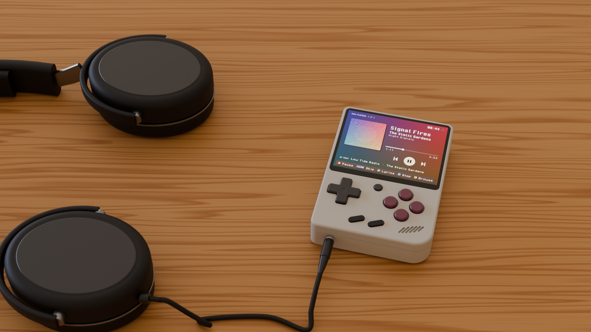

<p align="center"></p>

[](https://github.com/zakijss/MiniTape/actions/workflows/ci.yml)
[](https://github.com/zakijss/MiniTape/releases)
[](LICENSE)

# MiniTape

A music player for [Navidrome](https://www.navidrome.org) and other Subsonic servers, on a Miyoo Mini Plus. The music keeps playing in the Onion menu and in other apps, and pauses for games. Part of [MiniDeck](https://github.com/zakijss/MiniDeck).

- Recently added, random, most played and starred albums, artists, playlists, and **Shuffle everything** in one press.
- Plays in the background, with the song scrolling across the top of the screen; **Settings > Background playback** turns that off.
- Synced lyrics, covers drawn in the interface's pixel style, and scrobbling to Last.fm and ListenBrainz.
- Songs download to the card ahead of the music, the next one while the last plays, so they start at once and Wi-Fi drops aren't heard; the bit rate steps down when the link can't keep up. Up to 500 MB of songs (by default) stay on the card and play again offline.
- **Settings** also sets the streaming quality (96 to 320 kbit/s), how much of the card downloaded songs may use (100 MB to 1 GB) and clears them, and turns the Onion menu ticker on or off.
- The audio path runs with real-time scheduling while music plays, so it keeps time with the Onion menu open.


<p align="center"></p>

## Using it

The first start asks for your server, user name and password. On the now-playing screen **A** pauses, **L1**/**R1** skip, **Y** shows the lyrics, **X** stops and **B** goes back. **SELECT** opens the now-playing screen from anywhere in the app.

MiniTape asks the server for MP3 (192 kbit/s by default; **Settings > Streaming quality**, or `format` and `max_bitrate` in `App/MiniTape/settings.json`), since the device's FFmpeg is old, so Navidrome needs ffmpeg for transcoding. Servers on your tailnet work through [MiniScale](https://github.com/zakijss/MiniScale).

## Install

- **MiniMart:** open [MiniMart](https://github.com/zakijss/MiniMart), then **Apps > MiniTape**. It checks the download and keeps your settings on updates.
- **Zip:** download `minitape-VERSION.zip` from [Releases](https://github.com/zakijss/MiniTape/releases/latest), unzip it onto the root of the SD card, and restart.
- **Every MiniDeck app at once:** [minideck-all.zip](https://github.com/zakijss/MiniDeck/releases/latest/download/minideck-all.zip).

## Requirements

A Miyoo Mini Plus on Onion OS 4.4, with Wi-Fi. A Navidrome or other Subsonic server that can transcode to MP3. Other devices and firmwares aren't supported.

## Building

```sh
make check                     # vet, tests, scripts
make package VERSION=1.0.0     # dist/: the release zip, app.json, SHA256SUMS
make deploy HOST=root@miyoo    # build and copy to a device over SSH
```

Go runs in Docker unless you pass `GO=go` (Go 1.27). The interface, themes and networking come from the [MiniDeck library](https://github.com/zakijss/MiniDeck); see its [development notes](https://github.com/zakijss/MiniDeck/blob/main/docs/DEVELOPMENT.md) and [contributing guide](https://github.com/zakijss/MiniDeck/blob/main/CONTRIBUTING.md).

## License

[MIT](LICENSE). Third-party components are listed in [NOTICE](NOTICE). Not made by or affiliated with Miyoo.
