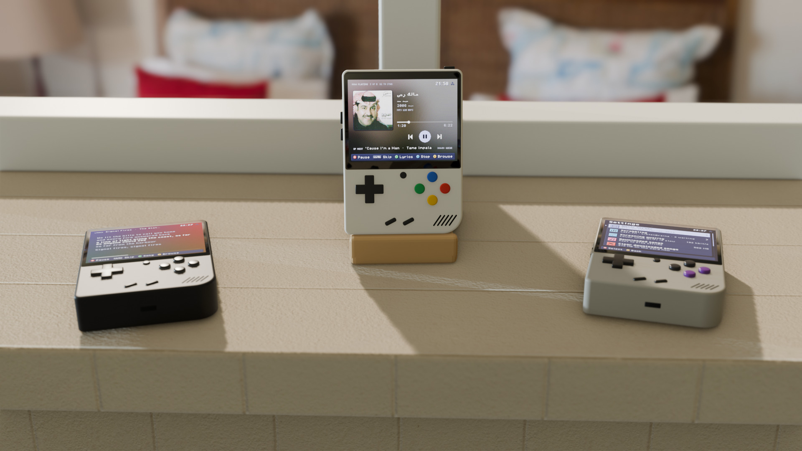
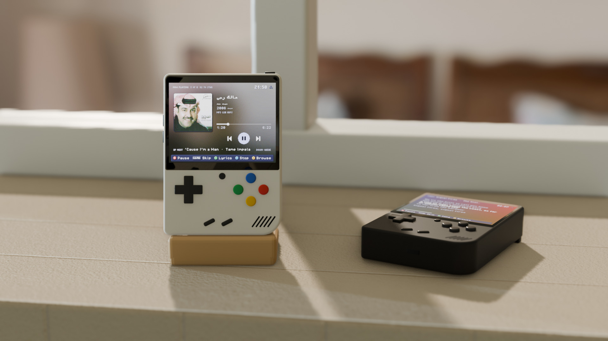

<p align="center"></p>

https://github.com/user-attachments/assets/c08e63c8-1a9c-4db1-be37-518af5fb1e93

[](https://github.com/zakijss/MiniTape/actions/workflows/ci.yml)
[](https://github.com/zakijss/MiniTape/releases)
[](LICENSE)

# MiniTape

A music player for [Navidrome](https://www.navidrome.org) and other Subsonic servers, the music on the SD card, and internet radio, on a Miyoo Mini Plus. The music keeps playing in the Onion menu and in other apps, and pauses for games. Part of [MiniDeck](https://github.com/zakijss/MiniDeck).

- Recently added, random, most played and starred albums, artists, playlists, search, and **Shuffle everything** in one press.
- **On this card** plays the music in `Media/Music` by folder, artist or album, with no server and no Wi-Fi.
- **Radio** plays stations from [radio-browser.info](https://www.radio-browser.info), with or without a server, and your server's own stations. It keeps favourites and shows the song a station is on when it sends the title.
- Plays in the background, with the song scrolling across the top of the screen.
- The queue, the song and the time in it are kept when MiniTape or the device turns off; the next start opens on them, paused.
- Synced lyrics, covers drawn in the interface's pixel style, a sleep timer, and scrobbling to Last.fm and ListenBrainz.
- Songs download to the card ahead of the music, so they start at once and Wi-Fi drops aren't heard; the bit rate steps down when the link can't keep up. Up to 500 MB of songs (by default) stay on the card and play again offline.

<p align="center"></p>

## Install

Open [MiniMart](https://github.com/zakijss/MiniMart) and pick **Apps > MiniTape**: it checks the download and keeps your settings on updates. Or unzip `minitape-VERSION.zip` from [Releases](https://github.com/zakijss/MiniTape/releases/latest) onto the root of the SD card and restart. Every MiniDeck app comes in one zip too: [minideck-all.zip](https://github.com/zakijss/MiniDeck/releases/latest/download/minideck-all.zip).

Needs a Miyoo Mini Plus on Onion OS 4.4. For a server or radio, Wi-Fi; a Navidrome or other Subsonic server must be able to transcode to MP3 (Navidrome needs ffmpeg). Other devices and firmwares aren't supported.

## Using it

The first start asks for your server, user name and password, or to play only the music on the card (a server can be added later in **Settings > Music server**). Servers on your private network (Tailscale, Headscale, WireGuard or NetBird) work through [MiniScale](https://github.com/zakijss/MiniScale).

In the lists, **Y** refreshes from the server (lists open at once from the copy on the card), **X** shuffles an album or playlist, and **L2**/**R2** jump to the top and the bottom. In Artists, and in Albums and Folders on the card, **Left**/**Right** go to the previous or next letter (the server's artists by its own letters, so "The Beatles" may be under B); elsewhere they move six rows, as **L1**/**R1** do. **SELECT** opens the now-playing screen from anywhere else in the app.

<details>
<summary><b>Now playing and the queue</b></summary>

| Now playing | |
|---|---|
| A | pause, play |
| L1 / R1 | previous / next song |
| Left / Right | back / forward 10 seconds |
| R2 | star or unstar |
| L2 | repeat all, one, off |
| SELECT | sleep timer |
| Y | lyrics |
| Down | the queue |
| X | stop |
| B | back |

In the queue, **A** plays the selected song, **X** takes it out (not the current one), **L2**/**R2** move it up and down, and **B** goes back.

The sleep timer pauses the music after 15 to 90 minutes, or at the end of the song, and keeps counting with MiniTape closed. The Miyoo can't tell when headphones are plugged in or out (the jack switches the speaker off by itself), so MiniTape doesn't pause on unplugging.

</details>

### Radio

**Radio** on the first screen lists popular and trending stations, genres, countries, languages, a search, and your server's internet radio stations if it has any. In a list, **A** plays a station, **X** stars it (starred stations are under **Favourites**) and **Y** asks the directory again. Lists are kept on the card (stations for 6 hours, genres, countries and languages for a week) and still open with no network.

On the now-playing screen a station shows LIVE, its format and bit rate. **L1**/**R1** go to the previous or next station in its list, **R2** stars it, and **A** stops it; pressed again it tunes in live. A stream that drops is connected again, and the last station is there on the next start.

**Radio > Options** sorts the lists by their own order (by votes in Popular, recent listens in Trending), popularity, trending, name or bit rate. It can also hide stations that failed the directory's last check, keep only MP3 and AAC streams, and leave out stations below 64 or 128 kbit/s; these never hide a favourite. Starting a station counts a listen with the directory, which asks players to do this; stations are never sent to Last.fm, ListenBrainz or the server.

### Music on the card

Copy music to `Media/Music` on the SD card, in any folders (set `music_dir` in `App/MiniTape/settings.json` for another folder): MP3, FLAC, Ogg, Opus, M4A, AAC and WAV. **Folders** follows the folders; **Artists** and **Albums** come from the songs' tags. The first visit reads every file's tags, which takes a while for a large collection; after that the lists open at once, and **Y** reads the folder again. A `cover.jpg`, `folder.jpg` or `front.jpg` in a folder is its cover, otherwise the picture inside the song's file (up to 8 MB). Lyrics come from a `.lrc` file with the song's name, or from its tags. Songs on the card can't be starred, and go to Last.fm and ListenBrainz only when tagged with an artist.

### Settings

**Settings** has the streaming quality (MP3 at 96 to 320 kbit/s, 192 by default, since the device's FFmpeg is old), how much of the card downloaded songs may use (100 MB to 1 GB) and clearing them, background playback, and the Onion menu ticker. `format` and `max_bitrate` can also be set in `App/MiniTape/settings.json`.

## Building

```sh
make check                     # vet, tests, scripts
make package VERSION=1.0.0     # dist/: the release zip, app.json, SHA256SUMS
make deploy HOST=root@miyoo    # build and copy to a device over SSH
```

Go runs in Docker unless you pass `GO=go` (Go 1.27). The interface, themes and networking come from the [MiniDeck library](https://github.com/zakijss/MiniDeck); see its [development notes](https://github.com/zakijss/MiniDeck/blob/main/docs/DEVELOPMENT.md) and [contributing guide](https://github.com/zakijss/MiniDeck/blob/main/CONTRIBUTING.md).

## License

[MIT](LICENSE). Third-party components are listed in [NOTICE](NOTICE). Not made by or affiliated with Miyoo.
